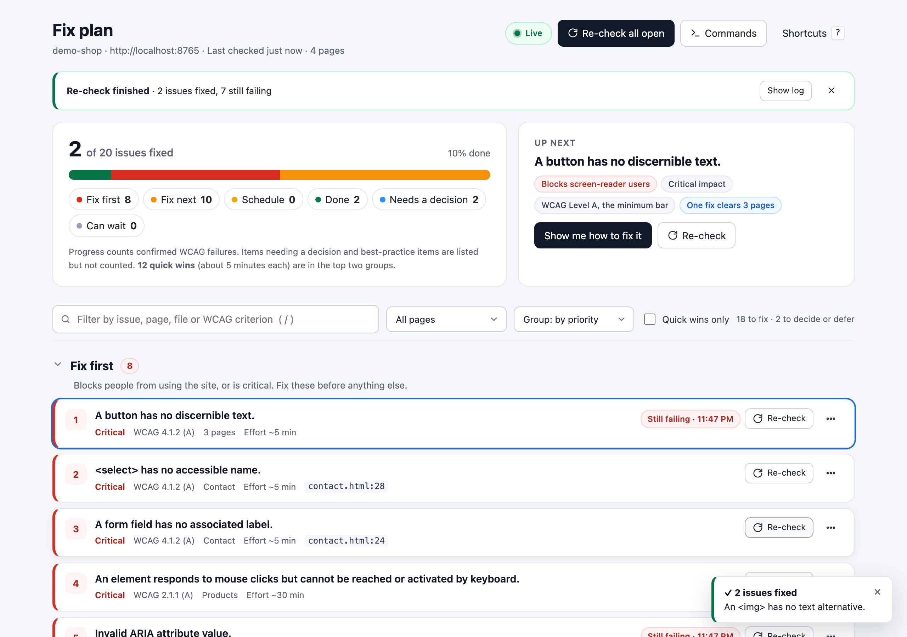
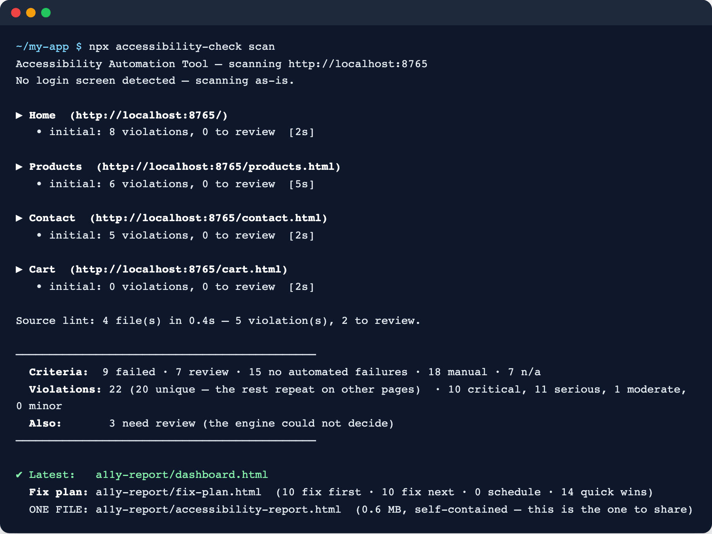
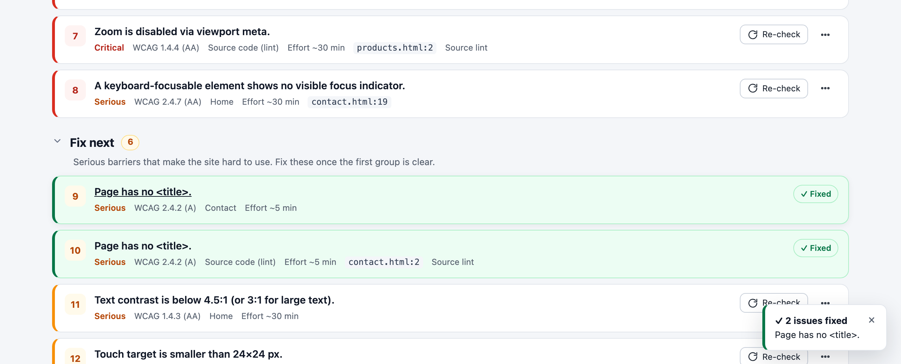
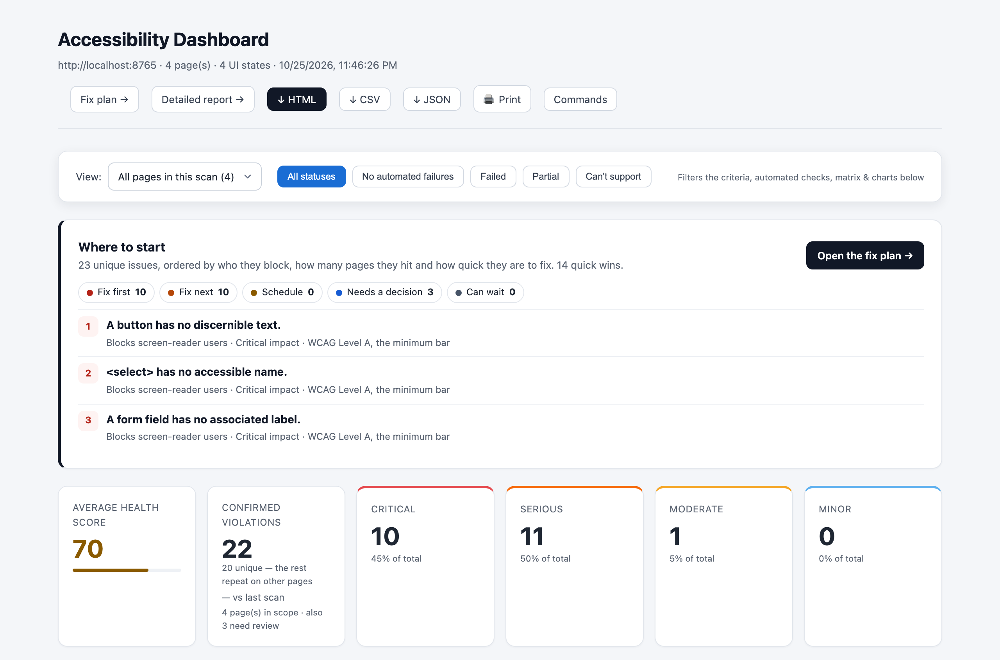
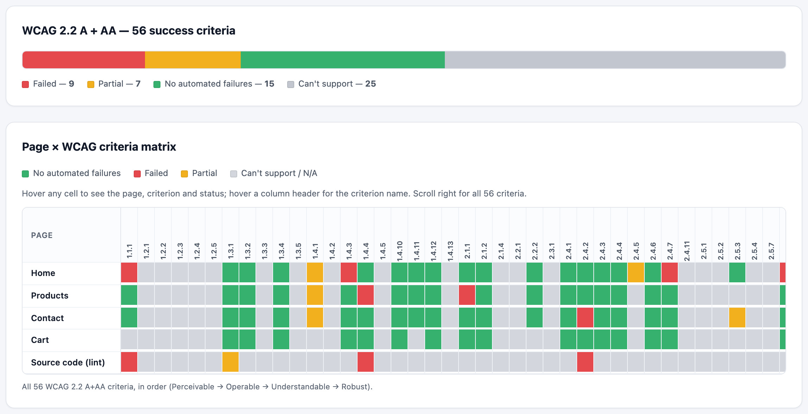
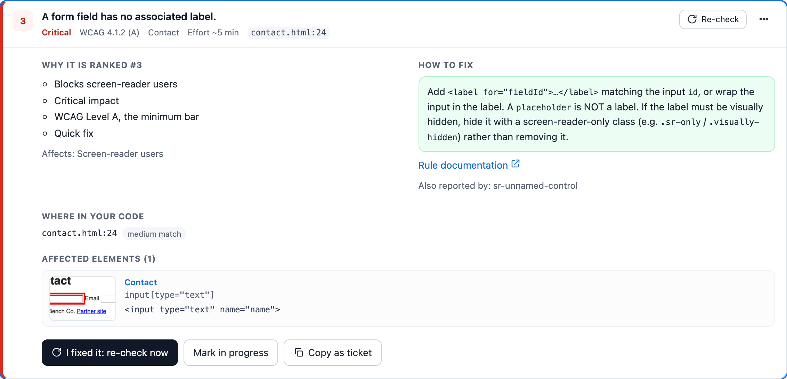
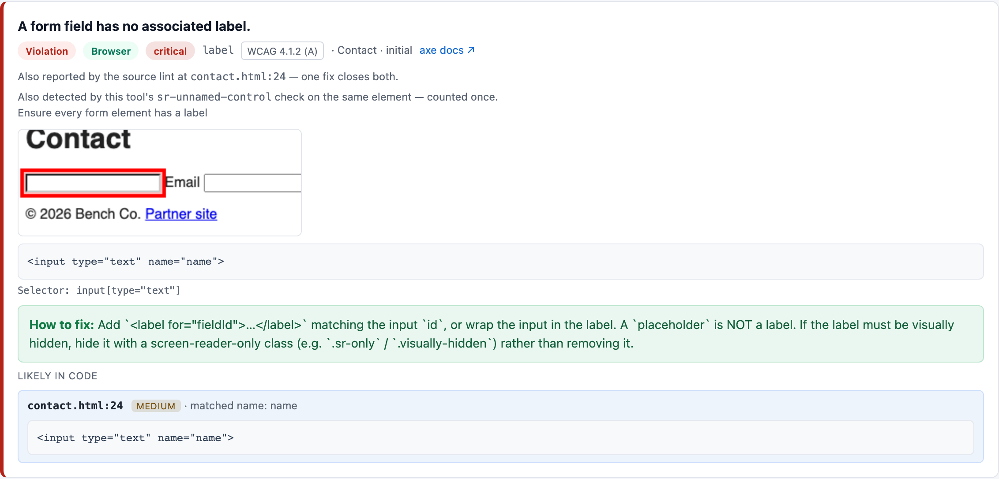
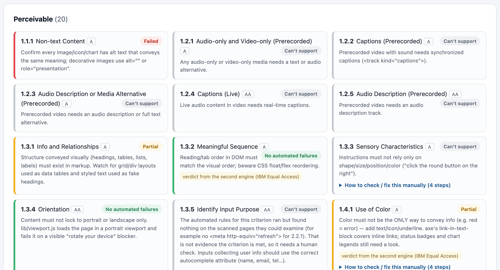
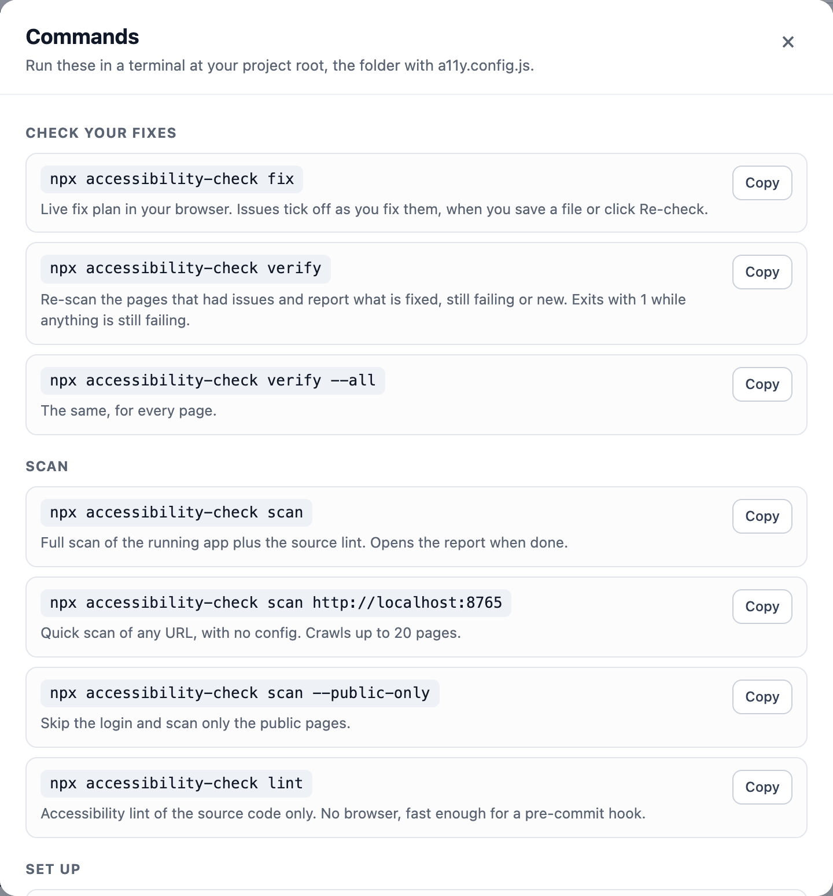

# accessibility-check

[](LICENSE)


WCAG 2.2 A + AA accessibility checks for **any web project**: React, Next.js, Angular, Vue/Nuxt, ASP.NET Core, ASP.NET Web Forms, or a plain HTML site.

- **Scans the running app** in a real browser with two rule engines (axe-core and IBM Equal Access) plus its own keyboard, focus, screen-reader, contrast, zoom and form checks. It also scans the dialogs, menus and tabs it opens.
- **Lints your source** (JSX/TSX, Vue, Angular templates, HTML) and points to the exact `file:line`.
- **Tells you what to fix first.** The fix plan ranks issues by who they block, how many pages they hit and how quick they are to fix.
- **Proves your fixes worked.** Re-checks say *fixed*, *still failing* or *new*, and never guess.
- **Handles login screens**, and runs in CI with JUnit output and a build gate.

<p align="center"></p>
<p align="center"><sub>The fix plan: what to fix first, why, and live progress as you fix things.</sub></p>

> **Not on the npm registry.** Install it straight from this GitHub repository, as shown below.

## Before you start
- **Node.js 20 or newer.** Check with `node -v`.
- **Git installed** (`git --version`). npm uses it to download the tool from GitHub. No GitHub account or sign-in is needed.
- About 150 MB of disk space. On first run the tool offers to download Chromium, the browser it scans with.

You don't need to clone this repository; npm fetches it for you.

## Install
In **your project's** root folder (the app you want to check), use the package manager your project already uses:
```bash
npm i -D git+https://github.com/zensi-korat/Accessibility-checker-tool.git          # npm (package-lock.json)
pnpm add -D git+https://github.com/zensi-korat/Accessibility-checker-tool.git       # pnpm (pnpm-lock.yaml)
yarn add -D accessibility-check@git+https://github.com/zensi-korat/Accessibility-checker-tool.git   # yarn (yarn.lock)
```
If pnpm says `ERR_PNPM_ADDING_TO_ROOT` (the project has a `pnpm-workspace.yaml`), add `-w`: `pnpm add -D -w git+https://github.com/zensi-korat/Accessibility-checker-tool.git`.

This adds `accessibility-check` to your project's `devDependencies`. Teammates on that project then get it with a normal `npm install`.

> Install first. Until it is installed in the project, `npx accessibility-check` looks on the public npm registry, where this tool doesn't exist.

**Just trying it?** Scan any site without adding anything to a project:
```bash
npx github:zensi-korat/Accessibility-checker-tool scan https://staging.example.com
```
It crawls up to 20 pages and opens the report.

## Use it in your project
```bash
npx accessibility-check init      # detect your stack, write a11y.config.js, list your pages
npx accessibility-check scan      # start the app, scan every page + lint the source, open the report
npx accessibility-check fix       # live fix plan: issues tick off as you fix them
npx accessibility-check verify    # re-check: ✔ fixed · ✗ still failing · ⚠ new · ? couldn't verify
npx accessibility-check scan --only contrast,aria,links   # check just these issue types
```
In a pnpm project use `pnpm exec accessibility-check …`; with yarn, `yarn accessibility-check …`. The tool's own hints follow whichever you use.

**How long a scan takes:** about 30 seconds of setup, plus a few seconds per page. A small site takes under a minute; a 20–30 page app takes a few minutes. The first run also downloads the browser, once per machine.

<p align="center"></p>

## Re-check your fixes
Fix something, then either:
- run `npx accessibility-check verify`, which re-scans only the pages that had issues and reports ✔ fixed · ✗ still failing · ⚠ new, or
- keep `npx accessibility-check fix` open while you work. Save a file (or click **Re-check**) and the cards update in place: proven fixes turn green and move to **Done**, and anything new is flagged.

<p align="center"></p>

A fix only counts when a re-scan proves it. If the page or dialog couldn't be checked again, the issue is listed as *couldn't verify*, never as fixed.

## Updating
Your lockfile pins the commit you installed, so `npm install` keeps giving you that version. To get the latest, run the install command again:
```bash
npm i -D git+https://github.com/zensi-korat/Accessibility-checker-tool.git
pnpm add -D git+https://github.com/zensi-korat/Accessibility-checker-tool.git
yarn add -D accessibility-check@git+https://github.com/zensi-korat/Accessibility-checker-tool.git
```
Commit the updated lockfile so teammates get the same version. To stay on a tagged release instead, add the tag to the URL, for example `npm i -D git+https://github.com/zensi-korat/Accessibility-checker-tool.git#v0.2.0`. Check which version you have with `npm ls accessibility-check`.

## If installing fails
| Message | Fix |
|---|---|
| `spawn git ENOENT` / `git: command not found` | Git isn't installed. Install it from [git-scm.com](https://git-scm.com/) and try again. |
| `404 Not Found … accessibility-check` | You ran `npx accessibility-check` before installing. Run the install command first. |
| `Cannot read properties of null (reading 'matches')` | You ran npm in a pnpm (or yarn) project. Install with that project's package manager instead (see [Install](#install)). |
| `ERR_PNPM_ADDING_TO_ROOT` | The project is a pnpm workspace. Add `-w` to install at the root, or `--filter <app>` to install into one app. |
| `Unsupported engine` / `requires node >= 20` | Update Node.js to version 20 or newer. |
| `npm warn deprecated eslint@9…` | Expected and harmless. The tool stays on ESLint 9 until its React lint rules support ESLint 10. |

## Commands
| Command | What it does |
|---|---|
| `scan` | Full scan of the running app plus the source lint. Opens the report. |
| `scan <url>` | Quick scan of any URL with no config (`--max-pages N`, default 20). |
| `scan --public-only` | Skip the login and scan public pages only. |
| `fix` | Live fix plan in your browser. Re-checks when you save a file or click Re-check. `--no-watch`, `--port N` |
| `verify` | Re-scan the pages that had issues and report fixed / still failing / new (`--all` for every page). |
| `lint` | Source lint only, no browser, fast enough for a pre-commit hook (`--json`, `--strict`). |
| `init` | Detect the stack, write `a11y.config.js`, discover routes (`--ci github\|azure\|gitlab` adds a pipeline). |
| `discover` | Rebuild the routes list from source (`--live` adds sitemap.xml and a read-only crawl). |
| `login` | Log in once and save the session, for scans behind a login and for CI. |
| `render` / `combine` | Rebuild reports from the last scan / merge every archived run. |

The same list, with copy buttons, is under **Commands** in the report.

## What it checks
All **56 WCAG 2.2 Level A and AA success criteria** are listed in the report, each with a status. Automated checks cover:

| Area | Examples |
|---|---|
| Images and text alternatives | Missing or empty `alt`, unlabelled icons and SVGs |
| Forms | Inputs and selects without labels, asking for the same information twice |
| Screen readers | Buttons and links without a name, invalid ARIA, broken `aria-labelledby`, focusable content hidden with `aria-hidden` |
| Keyboard | Click handlers that keyboards can't reach, keyboard traps, missing focus indicators, focus order |
| Colour and contrast | Text contrast (including over images and gradients), contrast of controls and borders |
| Zoom and layout | Zoom disabled, content cut off at 200% or 320 px wide, text spacing, orientation lock |
| Structure | Page titles, page language, headings, landmarks, lists and tables |
| Touch | Targets smaller than 24×24 px |
| Consistency | Navigation, help links and labels that change from page to page |
| Hidden UI | Dialogs, menus, tabs and accordions are opened and checked too |
| Your source code | JSX/TSX, Vue, Angular templates and HTML, with exact `file:line` |

Optional deeper checks, turned on with `LIVE_REGION_CHECKS: true` in the config, also submit forms and interact with the page, with network writes blocked so nothing is saved. They cover error messages and status announcements, content that changes on focus or input, hover pop-ups, and pointer cancellation.

Criteria that need a person, like whether alt text is *meaningful* or captions are *accurate*, are marked **Manual**, with steps for checking them.

## What you get
Everything is written to `a11y-report/`:

| File | Use it for |
|---|---|
| `accessibility-report.html` | **The one to share.** One self-contained file with three tabs: Dashboard, Fix plan, All findings. Screenshots are embedded. |
| `fix-plan.html` | Issues in the order to fix them: **Fix first → Fix next → Schedule → Needs a decision → Can wait → Done**. Each card says why it is ranked there, how to fix it for your stack, and where it is in your code. |
| `dashboard.html` / `report.html` | All 56 WCAG 2.2 A/AA criteria (Failed / Needs review / No automated failures / Manual / N/A) and every finding. |
| `report.json`, `a11y-results.xml` | Machine-readable results and JUnit for CI test tabs. |

Decisions you make in the fix plan (in progress, snoozed, won't fix) are saved to `a11y.triage.json`. Commit it to share them with your team.

> **What automation can and can't tell you.** Automated testing reliably covers about 30–40% of WCAG. "No automated failures" means nothing detectable is wrong, not that the site is accessible. The report lists which criteria still need a person, and how to check each one.

### A tour of the report
**Dashboard.** Where to start, plus totals by severity. Repeats across pages are counted once as *unique*.



**WCAG coverage.** All 56 criteria at a glance, and which page fails which criterion.



**Every issue explained.** Why it is ranked where it is, how to fix it, where it is in your code, and the affected elements with screenshots. Copy it as a ticket in one click.



<details>
<summary><b>More screenshots:</b> a finding in the detailed report, the criteria cards, and the Commands dialog</summary>

<br>

**A finding in the detailed report:** the element highlighted on the page, its HTML, the fix, and the matching line in your code.



**Criteria cards:** each WCAG criterion with its status and what a person should check.



**Commands:** every command in one place, with copy buttons (press `c` in the fix plan).



</details>

## Configuration
`init` writes this for you. Only `BASE_URL` is required:
```js
// a11y.config.js
module.exports = {
  BASE_URL: process.env.A11Y_BASE_URL || 'http://localhost:3000',
  REPO_PATH: '.',                      // source folder, for file:line locations and watch mode
  WEB_SERVER: { command: 'npm run dev' }, // optional: start the app before scanning
  FAIL_ON: { critical: 0 },            // optional: exit 1 above these counts
};
```
Every option is described in the [configuration reference](docs/GUIDE.md#12-configuration-reference).

## CI
```bash
npx accessibility-check init --ci github   # or azure, gitlab
```
This adds a pipeline that scans every pull request, publishes the report and JUnit results, and fails on confirmed critical violations. Thresholds are set with `A11Y_FAIL_ON_CRITICAL`, `A11Y_FAIL_ON_SERIOUS` or `A11Y_FAIL_ON_TOTAL`. Only confirmed WCAG violations count: "needs review" and best-practice findings never fail a build.

> **Install step:** the generated pipeline installs `accessibility-check@0` from the npm registry, where this tool isn't published. In the generated file, replace `accessibility-check@0` with `git+https://github.com/zensi-korat/Accessibility-checker-tool.git`. No token is needed, because the repository is public.

Exit codes: `0` passed · `1` gate failed, or `verify` found issues still open · `2` setup problem (no config, app not reachable, login needed).

## Learn more
**📖 [The full guide](docs/GUIDE.md)** covers setup, logging in, reading the report, the fix plan, fixing and verifying, hidden UI (dialogs, tabs), CI, Playwright tests, Docker, every config option, and FAQ.

## Contributing
```bash
npm install
npx playwright install chromium
npm test
```
How the code is organised:
- `bin/a11y.js`: the CLI.
- `scan.js`: the browser scan.
- `lib/static/`: the source lint.
- `lib/priority.js` and `lib/fixPlan.js`: the fix plan.
- `lib/fixServer.js`: `fix`.
- `lib/verify.js`: fix verification.
- `lib/adapters/`: route discovery for each stack.
- `lib/aggregate.js` → `lib/report.js`: WCAG mapping and the reports.

Releasing: [docs/PUBLISHING.md](docs/PUBLISHING.md).

## License
[MIT](LICENSE)
